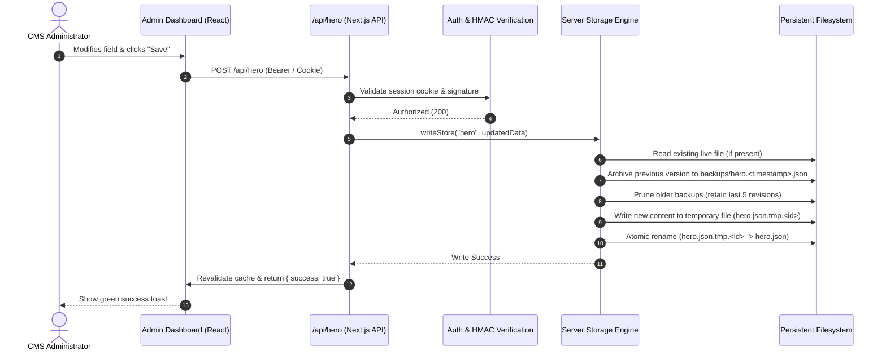

# Shirin Shila Portfolio — Production Data Persistence Architecture

> **Document Status:** Active Production Architecture Standard  
> **Target Environment:** Hostinger Node.js Web Hosting & Linux Cloud Server  
> **Persistence Standard:** Zero-Database Decoupled Storage with Rolling Revisions  
> **Last Verified:** October 2026  

---

## 1. Executive Summary & Zero-Data-Loss Guarantee

This document defines the data persistence architecture for the official **Shirin Shila** portfolio website. The platform operates on a **Zero-Database (Zero-DB) Architecture** utilizing structured JSON data stores, atomic filesystem operations, cryptographic media verification, and an out-of-band persistent storage directory decoupled from version-controlled git release checkouts.

### Core Persistence Guarantee
> [!IMPORTANT]
> **Edits made by administrators in the CMS and all uploaded media are guaranteed never to be deleted, reset, or overwritten by Git pushes, Hostinger auto-deployments, server rebuilds, or process restarts.**

---

## 2. Root Cause Analysis: How Hostinger Deployments Work & Why Git Overwrite Occurred

When deploying a Node.js application from GitHub onto Hostinger:
1. Hostinger clones the repository into a release directory structure (typically under `domains/{domain}/public_html/versions/{uuid}` or directly in `public_html`).
2. It runs `npm install` followed by `npm run build`.
3. It switches a runtime symlink (`current`) to point to the freshly built release UUID folder.
4. If runtime application data (such as JSON files or user-uploaded media) is stored inside the git repository checkout (e.g., `src/data/store/*.json` or `public/uploads/*`), each new deployment checks out clean git-tracked files, completely discarding or resetting changes made through the live CMS.

### The Decoupled Persistent Storage Solution
To achieve complete immunity against Git deployments without introducing external databases:
- The active storage layer is moved **outside** the versioned release directories into a permanent user-level storage directory:
  ```text
  /home/u473489494/shirin_shila_persistent_data/
  ├── store/              # Runtime JSON content stores
  ├── uploads/            # User-uploaded images, videos, press PDFs
  └── backups/            # Timestamped rolling backups & pre-restore snapshots
  ```
- The application automatically detects this directory via `src/lib/persistent-paths.ts`.
- Files committed to the GitHub repository serve strictly as **seed/fallback templates** during initial cold-starts and are never touched once a live file is created in the persistent directory.

---

## 3. Directory Layout & File Paths

### Production (Hostinger Linux Environment)
| Type | Path on Hostinger Server | Purpose |
| :--- | :--- | :--- |
| **Persistent Content Store** | `/home/u473489494/shirin_shila_persistent_data/store` | Active JSON stores modified by admin CMS |
| **Persistent Media Uploads** | `/home/u473489494/shirin_shila_persistent_data/uploads` | Uploaded images, posters, headshots |
| **Persistent Backups** | `/home/u473489494/shirin_shila_persistent_data/backups` | Automated rolling revisions (last 5 per section) |
| **Seed / Default Store** | `.../public_html/src/data/store` | Read-only bootstrap fallback committed to Git |
| **Static Brand Assets** | `.../public_html/public/images` | Curated static assets (e.g. `shirin-akter.png`) |

### Development / Local Environment
In local development (Windows / macOS), if environment variables are not specified, the system gracefully defaults to:
- Content Store: `<project_root>/src/data/store`
- Uploads: `<project_root>/public/uploads`
- Backups: `<project_root>/backups`

Explicit environment overrides can be configured in `.env.local` or Hostinger Environment Variables:
```env
DATA_STORE_DIR=/path/to/custom/store
MEDIA_UPLOADS_DIR=/path/to/custom/uploads
BACKUPS_DIR=/path/to/custom/backups
```

---

## 4. Protected Data Stores & Schemas

The following 12 JSON stores are actively managed and shielded:

1. **`hero.json`** — Headlines, eyebrow, stage name, roles, intro paragraph, CTA links, and primary banner image reference.
2. **`about.json`** — Full career narrative, personal biography, signature quote, milestones, statistics, and biography photo.
3. **`filmography.json`** — Complete movie projects list (titles, directors, roles, release years, status, badges, poster URLs, and synopsis).
4. **`gallery.json`** — High-definition photo gallery categorized by Red Carpet, Cinema, Photoshoots, and Traditional.
5. **`showreels.json`** — Video showreels, YouTube embeds, featured clips, and performance trailers.
6. **`timeline.json`** — Career accolades, National/Critique awards, milestone achievements, and timeline entries.
7. **`press.json`** — Major media coverage, news interviews (Prothom Alo, Daily Star, etc.), quotes, and external links.
8. **`mediaPartners.json`** — Broadcast partners, television network logos, and OTT platforms.
9. **`contactInfo.json`** — Talent management contact, representation emails, official phone numbers, and social channels.
10. **`seo.json`** — SEO title, meta description, OpenGraph preview image, Twitter cards, keywords, and custom head code scripts.
11. **`inquiries.json`** — Casting inquiries, commercial booking requests, client submissions, and reply tracking.
12. **`media-manifest.json`** — Complete media asset registry including SHA-256 cryptographic hashes, MIME types, file sizes, and usage tracking.

---

## 5. Lifecycle of a CMS Content Edit

When an administrator submits an update via the Admin CMS (e.g., updating the Hero Section):



### Key Safety Guardrails in the Write Pipeline
- **Atomic Operations (`fs.renameSync` / `fs.promises.rename`)**: Writing first to a temporary file before renaming prevents partial or corrupt file writes if the server crashes or restarts mid-write.
- **Automated Rolling Backups**: Before any overwrite occurs, a timestamped snapshot is archived into `backups/`. The last 5 revisions are automatically retained.
- **Cache Invalidation (`revalidatePath`)**: The frontend instantly reflects changes without requiring a Node.js process restart.

---

## 6. Cold Start, Server Restarts, and Redeployment Behavior

When the Next.js server boots or cold starts after a GitHub deployment:

1. **Path Resolution**: `src/lib/persistent-paths.ts` evaluates the environment. On Linux, it targets `/home/u473489494/shirin_shila_persistent_data/store`.
2. **Directory Initialization**: If the persistent directories do not yet exist, they are created with standard user permissions (`0755`).
3. **Seed Check**: When an API route calls `readStore(key)`:
   - If the file exists in the persistent store, it is read and served directly.
   - If the file does **not** exist in the persistent store (e.g. brand new deployment on a blank server), the system reads the default seed JSON from `src/data/store/{key}.json` and copies it into the persistent store.
4. **Subsequent Deploys**: Even when a new commit updates the seed JSON in Git, the persistent store is **never overwritten** because the persistent file already exists!

---

## 7. Media Upload Architecture & Safe Asset Serving

### Upload Handling
- Media files uploaded through `/admin/media` or section image pickers are inspected for magic bytes (preventing file extension spoofing) and hashed via SHA-256.
- If duplicate file bytes already exist, the existing asset URL is returned, saving server storage.
- Valid new files are written to the persistent uploads directory:  
  `/home/u473489494/shirin_shila_persistent_data/uploads/{folder}/{unique-name}.ext`

### Asset Delivery
Two synchronized delivery layers serve uploaded media directly to web visitors:
1. **Hostinger `server.js` Static Streamer**: Fast native Node.js read-stream delivery with HTTP 200, immutable cache headers (`Cache-Control: public, max-age=31536000, immutable`), and security header `X-Content-Type-Options: nosniff`.
2. **Next.js App Route (`src/app/uploads/[...slug]/route.ts`)**: Serves as the high-availability App Router fallback with strict path sanitization preventing directory traversal (`..` blocking).

---

## 8. Backup, Export, and Disaster Recovery Procedures

### 1-Click Backup Export
- Administrators can download an offline `.json` archive containing all CMS data stores and media manifests anytime from `/admin/backup` or by calling `GET /api/backup?download=true`.
- Backups include full JSON trees for all sections, metadata, timestamps, and section counts.

### 1-Click Restore with Automated Pre-Restore Snapshot
- In `/admin/backup`, admins can upload any previous backup JSON file.
- Before restoring, the server automatically captures a snapshot of the current state into `backups/snapshot-<timestamp>.json`.
- Each valid section is validated and written atomically.

### Manual Server-Side Recovery (CLI)
If an admin accidentally overwrites data and wants to recover from the server CLI:
```bash
# SSH into Hostinger
ssh u473489494@your-server-ip

# Navigate to persistent backups
cd /home/u473489494/shirin_shila_persistent_data/backups

# List recent revisions
ls -la

# Restore a specific section revision
cp hero.2026-10-30T10-00-00-000Z.json ../store/hero.json
```

---

## 9. Security, Permissions & Concurrency

1. **Decoupled from Web Root**: Storing persistent data outside `public_html` prevents direct HTTP access to raw JSON files. The only access is through authenticated Next.js API routes.
2. **Session Authentication**: All write operations require a cryptographically verified HMAC session cookie signed by `ADMIN_SECRET`.
3. **Path Traversal Defense**: All file paths use `path.resolve()` and verify that the target starts with the designated root path, rejecting any malicious `..` segments.
4. **Concurrency Safety**: Node.js event-loop serialization combined with atomic file renames ensures that simultaneous writes cannot interleave or corrupt data.

---

## 10. Future Developer Guidelines

1. **NEVER** use hardcoded paths like `./src/data/store` for runtime writes in API handlers.
2. **ALWAYS** use `readStore()` and `writeStore()` from `@/lib/server-storage`.
3. **NEVER** write uploaded files directly into `public/` at runtime in production. Use `uploadMediaAsset()` from `@/lib/media-service`.
4. **ALWAYS** run `npm run build` locally before pushing to ensure type safety and bundling integrity.

