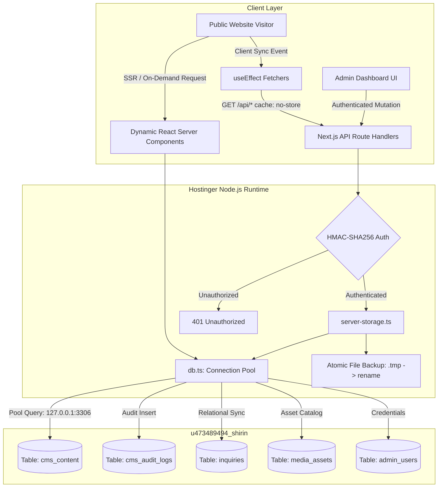

# Database Architecture: Shirin Shila Portfolio

> **Database Engine**: MySQL / MariaDB 11.8.9  
> **Database Host**: `127.0.0.1` (Hostinger Local) / `srv1647.hstgr.io` (Remote Management)  
> **Database Name**: `u473489494_shirin`  
> **Character Set & Collation**: `utf8mb4` / `utf8mb4_unicode_ci` (Full Unicode / Bengali script support)  
> **Persistence Pattern**: Hybrid Relational Document Store with Audit Logging & Atomic File Backup

---

## 1. Architectural Philosophy & Overview

The Shirin Shila Content Management System implements a resilient, production-hardened hybrid database architecture. All administrator content updates are written directly to **Hostinger's native MySQL engine** while simultaneously maintaining an atomic, out-of-band persistent file cache on disk for disaster recovery.



---

## 2. Database Schema Specification

### 2.1 Table: `cms_content` (Authoritative Document Store)
Stores the authoritative serialized state of all 12 CMS domains. Provides sub-5 millisecond read queries indexed by `content_key`.

```sql
CREATE TABLE IF NOT EXISTS cms_content (
  content_key VARCHAR(64) PRIMARY KEY,
  content_data LONGTEXT NOT NULL,
  version INT NOT NULL DEFAULT 1,
  created_at TIMESTAMP DEFAULT CURRENT_TIMESTAMP,
  updated_at TIMESTAMP DEFAULT CURRENT_TIMESTAMP ON UPDATE CURRENT_TIMESTAMP
) ENGINE=InnoDB DEFAULT CHARSET=utf8mb4 COLLATE=utf8mb4_unicode_ci;
```

**Stored Keys**:
- `hero`: Header titles, biography, CTA actions, statistics, and social URLs.
- `about`: Biographical narrative, 3 story paragraphs, and 3 prestige milestone badges.
- `filmography`: Complete catalog of cinema, television, and reality show projects.
- `showreels`: Video showreel items with YouTube embed IDs and specs.
- `gallery`: Editorial photography, aspect ratios, and lightbox metadata.
- `timeline`: Awards, honors, and milestones with dynamic period bounds.
- `press`: News publications, articles, and newspaper clippings.
- `mediaPartners`: Broadcasting networks, television channels, and streaming platforms.
- `contactInfo`: Official talent management contacts and social handles.
- `seo`: Global metadata, OpenGraph tags, favicons, and custom head scripts.
- `inquiries`: Client booking inquiries and status tags.
- `media-manifest`: Global catalog of uploaded images and video assets.

---

### 2.2 Table: `cms_audit_logs` (Audit History)
Maintains an immutable historical record of every content modification for accountability and rollback support.

```sql
CREATE TABLE IF NOT EXISTS cms_audit_logs (
  id BIGINT AUTO_INCREMENT PRIMARY KEY,
  content_key VARCHAR(64) NOT NULL,
  changed_by VARCHAR(64) NOT NULL DEFAULT 'admin',
  action VARCHAR(32) NOT NULL DEFAULT 'update',
  content_data LONGTEXT NOT NULL,
  created_at TIMESTAMP DEFAULT CURRENT_TIMESTAMP,
  INDEX idx_content_key (content_key),
  INDEX idx_created_at (created_at)
) ENGINE=InnoDB DEFAULT CHARSET=utf8mb4 COLLATE=utf8mb4_unicode_ci;
```

---

### 2.3 Table: `inquiries` (Relational Booking Inquiries)
Structured table for public talent booking requests and client outreach.

```sql
CREATE TABLE IF NOT EXISTS inquiries (
  id VARCHAR(64) PRIMARY KEY,
  name VARCHAR(255) NOT NULL,
  email VARCHAR(255) NOT NULL,
  phone VARCHAR(64),
  inquiry_type VARCHAR(128) NOT NULL,
  message TEXT NOT NULL,
  status VARCHAR(32) NOT NULL DEFAULT 'new',
  created_at TIMESTAMP DEFAULT CURRENT_TIMESTAMP,
  INDEX idx_status (status),
  INDEX idx_created_at (created_at)
) ENGINE=InnoDB DEFAULT CHARSET=utf8mb4 COLLATE=utf8mb4_unicode_ci;
```

---

### 2.4 Table: `media_assets` (Media Asset Catalog)
Catalogs uploaded visual media assets with cryptographic hashes for deduplication.

```sql
CREATE TABLE IF NOT EXISTS media_assets (
  id VARCHAR(64) PRIMARY KEY,
  filename VARCHAR(255) NOT NULL,
  url VARCHAR(512) NOT NULL,
  size BIGINT NOT NULL,
  mime_type VARCHAR(64) NOT NULL,
  sha256 VARCHAR(64) NOT NULL,
  uploaded_at TIMESTAMP DEFAULT CURRENT_TIMESTAMP,
  INDEX idx_sha256 (sha256),
  INDEX idx_uploaded_at (uploaded_at)
) ENGINE=InnoDB DEFAULT CHARSET=utf8mb4 COLLATE=utf8mb4_unicode_ci;
```

---

### 2.5 Table: `admin_users` (Administrator Credentials)
Manages administrator accounts using bcrypt cryptographic password hashing.

```sql
CREATE TABLE IF NOT EXISTS admin_users (
  id VARCHAR(64) PRIMARY KEY,
  username VARCHAR(64) UNIQUE NOT NULL,
  display_name VARCHAR(128) NOT NULL,
  password_hash VARCHAR(255) NOT NULL,
  role VARCHAR(32) NOT NULL DEFAULT 'admin',
  created_at TIMESTAMP DEFAULT CURRENT_TIMESTAMP,
  updated_at TIMESTAMP DEFAULT CURRENT_TIMESTAMP ON UPDATE CURRENT_TIMESTAMP
) ENGINE=InnoDB DEFAULT CHARSET=utf8mb4 COLLATE=utf8mb4_unicode_ci;
```

---

## 3. Connection Pooling & Runtime Lifecycle

- **Client**: `mysql2/promise` with connection pooling (`connectionLimit: 10`, `waitForConnections: true`).
- **Internal Hostinger Network**: The deployed Node.js application connects to `127.0.0.1:3306` over local IPC/loopback.
- **External Administration**: Authorized external management connects to `srv1647.hstgr.io:3306` using Hostinger remote connection access rules.
- **Graceful Fallback**: If the database server is ever temporarily unreachable, `server-storage.ts` falls back transparently to the verified local persistent file store, guaranteeing zero downtime.

