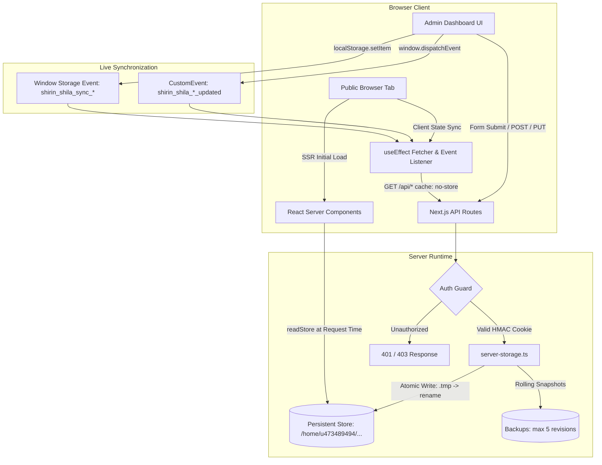

# Full-Stack Connection Map: Shirin Shila Portfolio

> **Authoritative Specification & Complete Field-Level Traceability Matrix**  
> **Environment**: Next.js 14 App Router, Zero-DB Persistent JSON Storage, Hostinger Node.js Web Hosting  
> **Production Target**: `https://cornflowerblue-wildcat-675604.hostingersite.com/`  
> **Repository**: [mrrajrumel/Shirin-Shila](https://github.com/mrrajrumel/Shirin-Shila)

---

## 1. Architectural Overview & Data Lifecycle Contract

The Shirin Shila portfolio utilizes a decoupled, Zero-DB persistence architecture where state is stored on durable persistent storage outside the transient Git checkout directory.



---

## 2. Complete Traceability Matrix (12 CMS Modules)

| # | Domain / Collection | Admin Form Component | API Endpoint | Storage Key & Target File | Public Server Render Path | Public Client Component | Live Tab Sync Mechanism |
|---|---------------------|----------------------|--------------|---------------------------|---------------------------|-------------------------|-------------------------|
| 1 | **Hero** | `src/app/admin/hero/page.tsx` | `POST /api/hero` | `hero` (`hero.json`) | `src/app/page.tsx` (`readStore('hero')`) | `src/components/hero-motion.tsx` | `shirin_shila_hero_updated` + `shirin_shila_sync_hero` |
| 2 | **About** | `src/app/admin/about/page.tsx` | `POST /api/about` | `about` (`about.json`) | `src/app/page.tsx` (`readStore('about')`) | `src/components/one-page-about.tsx` | `shirin_shila_about_updated` + `shirin_shila_sync_about` |
| 3 | **Works (Filmography)** | `src/app/admin/works/page.tsx` | `POST /api/works` | `filmography` (`filmography.json`) | `src/app/page.tsx` (`readStore('filmography')`) | `src/components/one-page-filmography.tsx` | `shirin_shila_works_updated` + `shirin_shila_sync_works` |
| 4 | **Showreels** | `src/app/admin/showreel/page.tsx` | `POST /api/showreels` | `showreels` (`showreels.json`) | `src/app/page.tsx` (`readStore('showreels')`) | `src/components/showreel-section.tsx` | `shirin_shila_showreels_updated` + `shirin_shila_sync_showreels` |
| 5 | **Gallery** | `src/app/admin/gallery/page.tsx` | `POST /api/gallery` | `gallery` (`gallery.json`) | `src/app/page.tsx` (`readStore('gallery')`) | `src/components/3d-parallax-gallery.tsx` | `shirin_shila_gallery_updated` + `shirin_shila_sync_gallery` |
| 6 | **Timeline & Honors** | `src/app/admin/timeline/page.tsx` | `POST /api/timeline` | `timeline` (`timeline.json`) | `src/app/page.tsx` (`readStore('timeline')`) | `src/components/career-journey-timeline.tsx` | `shirin_shila_timeline_updated` + `shirin_shila_sync_timeline` |
| 7 | **Press & Clippings** | `src/app/admin/press/page.tsx` | `POST /api/press` | `press` (`press.json`) | `src/app/page.tsx` (`readStore('press')`) | `src/components/one-page-press.tsx` | `shirin_shila_press_updated` + `shirin_shila_sync_press` |
| 8 | **Media Partners** | `src/app/admin/media-partners/page.tsx` | `POST /api/media-partners` | `mediaPartners` (`mediaPartners.json`) | `src/app/page.tsx` (`readStore('mediaPartners')`) | `src/components/media-ticker-section.tsx` | `shirin_shila_partners_updated` + `shirin_shila_sync_partners` |
| 9 | **Contact Information**| `src/app/admin/contact/page.tsx` | `POST /api/contact` | `contactInfo` (`contactInfo.json`) | `src/app/page.tsx` (`readStore('contactInfo')`) | `src/components/one-page-contact.tsx` | `shirin_shila_contact_info_updated` + `shirin_shila_sync_contact` |
| 10 | **SEO & Metadata** | `src/app/admin/seo/page.tsx` | `POST /api/seo` | `seo` (`seo.json`) | `src/app/layout.tsx` (`generateMetadata()`) | `<head>` / `CustomHeadInjector` | `shirin_shila_seo_updated` + `shirin_shila_sync_seo` |
| 11 | **Inquiries (Leads)** | `src/app/admin/inquiries/page.tsx` | `POST /api/contact`, `PATCH /api/inquiries` | `inquiries` (`inquiries.json`) | N/A (Admin only) | `src/app/admin/inquiries/page.tsx` | Real-time polling / manual refresh |
| 12 | **Media Assets** | `src/app/admin/media/page.tsx` | `POST /api/upload`, `GET /api/media` | `media-manifest` (`media-manifest.json`) | Static upload route: `GET /uploads/[...slug]` | All components with media | Manifest update broadcasts |

---

## 3. Deep-Dive Field-Level Mapping

### Module 1: Hero Profile
- **Admin Component**: [`src/app/admin/hero/page.tsx`](file:///c:/Users/RajRu/Downloads/Shirin%20Shila/src/app/admin/hero/page.tsx)
- **Field Mappings**:
  - `profile.name` $\rightarrow$ Name heading (`HeroMotion`)
  - `profile.title` $\rightarrow$ Professional subtitle badge
  - `profile.bio` $\rightarrow$ Lead cinematic overview
  - `profile.image` $\rightarrow$ Primary portrait hero photo
  - `profile.backdropImage` $\rightarrow$ Ambient blurred background layer
  - `profile.stats` (`yearsExperience`, `filmsCompleted`, `awardsCount`, `socialFollowers`) $\rightarrow$ Quick metric ribbon
  - `profile.ctaButtons` (`primaryLabel`, `primaryHref`, `secondaryLabel`, `secondaryHref`) $\rightarrow$ Direct engagement actions
  - `profile.socialLinks` (`facebook`, `instagram`, `youtube`, `tiktok`, `imdb`, `wikipedia`) $\rightarrow$ Social icon dock
- **API Endpoint**: `POST /api/hero` & `GET /api/hero`
- **Validation**:
  - Sanitization via string normalization, URL scheme validation (`http://`, `https://`, or local `/`).
- **Storage Layer**: `writeStore('hero', payload)` $\rightarrow$ Atomic `.tmp` rename to `hero.json`.
- **Public SSR Route**: `src/app/page.tsx` reads `readStore<HeroProfile>('hero')`.
- **Cache Policy**: `dynamic = 'force-dynamic'`, `revalidate = 0`. Direct un-cached stream from disk.
- **Client Synchronization**:
  ```typescript
  window.dispatchEvent(new CustomEvent('shirin_shila_hero_updated'));
  localStorage.setItem('shirin_shila_sync_hero', Date.now().toString());
  ```

---

### Module 2: Biography, Story Paragraphs & Prestige Milestones
- **Admin Component**: [`src/app/admin/about/page.tsx`](file:///c:/Users/RajRu/Downloads/Shirin%20Shila/src/app/admin/about/page.tsx)
- **Field Mappings**:
  - `about.biography.heading` $\rightarrow$ Section headline
  - `about.biography.paragraphs[]` $\rightarrow$ Full narrative story text blocks (spacious multi-line textareas, no overlap)
  - `about.prestigeMilestones[0..2]` $\rightarrow$ 3 Signature Prestige Milestone Badges:
    - Card 1: `title` ("10+ Years"), `subtitle` ("Dhallywood Cinema"), `badge` ("Active Career"), `icon` ("film")
    - Card 2: `title` ("Babisas Award"), `subtitle` ("Best Actress"), `badge` ("Begum Jaan"), `icon` ("award")
    - Card 3: `title` ("M.Sc. Physics"), `subtitle` ("Jahangirnagar Univ"), `badge` ("First Class"), `icon` ("education")
  - `about.profileFacts[]` $\rightarrow$ Structured Quick Facts (Debut, Height, Education, etc.)
  - `about.meta.bannerImage` $\rightarrow$ Biography showcase portrait
- **API Endpoint**: `POST /api/about` & `GET /api/about`
- **Storage Layer**: `writeStore('about', payload)` $\rightarrow$ `about.json`.
- **Public Component**: [`src/components/one-page-about.tsx`](file:///c:/Users/RajRu/Downloads/Shirin%20Shila/src/components/one-page-about.tsx)
- **Client Synchronization**:
  ```typescript
  window.dispatchEvent(new CustomEvent('shirin_shila_about_updated'));
  localStorage.setItem('shirin_shila_sync_about', Date.now().toString());
  ```

---

### Module 3: Works & Filmography
- **Admin Component**: [`src/app/admin/works/page.tsx`](file:///c:/Users/RajRu/Downloads/Shirin%20Shila/src/app/admin/works/page.tsx)
- **Field Mappings**:
  - `item.title` & `item.banglaTitle` $\rightarrow$ Dual-language title display
  - `item.category` $\rightarrow$ Filter pill category ("Film", "Special Appearance", "Web / TV", "TV Show Judge")
  - `item.year` $\rightarrow$ Release year tag
  - `item.role` $\rightarrow$ Character name or credit
  - `item.director` & `item.coStar` $\rightarrow$ Production metadata credits
  - `item.posterImage` $\rightarrow$ Cinematic poster card
  - `item.videoUrl` / `item.youtubeId` $\rightarrow$ Direct trailer playback link
  - `item.featured` $\rightarrow$ Priority placement flag
- **API Endpoint**: `POST /api/works` & `GET /api/works`
- **Storage Layer**: `writeStore('filmography', items)` $\rightarrow$ `filmography.json`.
- **Public Component**: [`src/components/one-page-filmography.tsx`](file:///c:/Users/RajRu/Downloads/Shirin%20Shila/src/components/one-page-filmography.tsx)
- **Client Synchronization**:
  ```typescript
  window.dispatchEvent(new CustomEvent('shirin_shila_works_updated'));
  localStorage.setItem('shirin_shila_sync_works', Date.now().toString());
  ```

---

### Module 4: Showreels & Video Highlights
- **Admin Component**: [`src/app/admin/showreel/page.tsx`](file:///c:/Users/RajRu/Downloads/Shirin%20Shila/src/app/admin/showreel/page.tsx)
- **Field Mappings**:
  - `item.title` $\rightarrow$ Slide title
  - `item.youtubeId` $\rightarrow$ Direct YouTube video embed id
  - `item.thumbnail` $\rightarrow$ High-res custom poster thumbnail
  - `item.year`, `item.duration`, `item.director`, `item.coStar` $\rightarrow$ Spec overlay
  - `item.sceneHighlight` $\rightarrow$ Dramatic action teaser description
- **API Endpoint**: `POST /api/showreels` & `GET /api/showreels`
- **Storage Layer**: `writeStore('showreels', items)` $\rightarrow$ `showreels.json`.
- **Public Component**: [`src/components/showreel-section.tsx`](file:///c:/Users/RajRu/Downloads/Shirin%20Shila/src/components/showreel-section.tsx)

---

### Module 5: 3D Visual Gallery
- **Admin Component**: [`src/app/admin/gallery/page.tsx`](file:///c:/Users/RajRu/Downloads/Shirin%20Shila/src/app/admin/gallery/page.tsx)
- **Field Mappings**:
  - `item.url` $\rightarrow$ Image file location
  - `item.title` & `item.caption` $\rightarrow$ Photo modal lightbox description
  - `item.category` $\rightarrow$ Editorial classification ("Photoshoot", "Film Still", "Red Carpet")
  - `item.aspectRatio` $\rightarrow$ Grid rendering ratio ("portrait", "landscape", "square")
- **API Endpoint**: `POST /api/gallery` & `GET /api/gallery`
- **Storage Layer**: `writeStore('gallery', items)` $\rightarrow$ `gallery.json`.
- **Public Component**: [`src/components/3d-parallax-gallery.tsx`](file:///c:/Users/RajRu/Downloads/Shirin%20Shila/src/components/3d-parallax-gallery.tsx)

---

### Module 6: Career Journey & Awards Timeline
- **Admin Component**: [`src/app/admin/timeline/page.tsx`](file:///c:/Users/RajRu/Downloads/Shirin%20Shila/src/app/admin/timeline/page.tsx)
- **Field Mappings**:
  - `item.year` & `item.month` $\rightarrow$ Chronological index & position
  - `item.title` $\rightarrow$ Award or career milestone headline
  - `item.category` $\rightarrow$ "Award", "Film Debut", "Milestone", "Education"
  - `item.description` $\rightarrow$ Detailed citation or jury remark
  - `item.highlight` $\rightarrow$ Glowing golden border badge
  - Dynamic Period Label: Automatically calculated via `computeTimelinePeriodLabel(items)` (e.g. `2014 — 2026`)
- **API Endpoint**: `POST /api/timeline` & `GET /api/timeline`
- **Storage Layer**: `writeStore('timeline', payload)` $\rightarrow$ `timeline.json`.
- **Public Component**: [`src/components/career-journey-timeline.tsx`](file:///c:/Users/RajRu/Downloads/Shirin%20Shila/src/components/career-journey-timeline.tsx)

---

### Module 7: Press Coverage & News Clippings
- **Admin Component**: [`src/app/admin/press/page.tsx`](file:///c:/Users/RajRu/Downloads/Shirin%20Shila/src/app/admin/press/page.tsx)
- **Field Mappings**:
  - `item.title` $\rightarrow$ Headline
  - `item.publication` $\rightarrow$ Publisher name (e.g. Prothom Alo, Daily Star)
  - `item.date` $\rightarrow$ Publication date
  - `item.kind` $\rightarrow$ "News article" | "Newspaper clipping"
  - `item.link` $\rightarrow$ External source article URL
  - `item.image` $\rightarrow$ Article feature graphic or physical newsprint clipping
- **API Endpoint**: `POST /api/press` & `GET /api/press`
- **Storage Layer**: `writeStore('press', items)` $\rightarrow$ `press.json`.
- **Public Component**: [`src/components/one-page-press.tsx`](file:///c:/Users/RajRu/Downloads/Shirin%20Shila/src/components/one-page-press.tsx)

---

### Module 8: Media Partners & Broadcasters
- **Admin Component**: [`src/app/admin/media-partners/page.tsx`](file:///c:/Users/RajRu/Downloads/Shirin%20Shila/src/app/admin/media-partners/page.tsx)
- **Field Mappings**:
  - `item.name` $\rightarrow$ Network / Studio name
  - `item.logoUrl` $\rightarrow$ Vector or PNG channel badge
  - `item.category` $\rightarrow$ "TV Channel", "OTT Platform", "Production House"
  - `item.website` $\rightarrow$ Partner destination link
  - `item.active` $\rightarrow$ Live carousel display toggle
- **API Endpoint**: `POST /api/media-partners` & `GET /api/media-partners`
- **Storage Layer**: `writeStore('mediaPartners', items)` $\rightarrow$ `mediaPartners.json`.
- **Public Component**: [`src/components/media-ticker-section.tsx`](file:///c:/Users/RajRu/Downloads/Shirin%20Shila/src/components/media-ticker-section.tsx)

---

### Module 9: Contact & Official Representation
- **Admin Component**: [`src/app/admin/contact/page.tsx`](file:///c:/Users/RajRu/Downloads/Shirin%20Shila/src/app/admin/contact/page.tsx)
- **Field Mappings**:
  - `info.email` $\rightarrow$ Direct talent inbox
  - `info.phone` $\rightarrow$ Official hotline
  - `info.pressEmail` $\rightarrow$ Media desk address
  - `info.address` $\rightarrow$ Office address
  - `info.bookingNotice` $\rightarrow$ Lead time notice
  - `info.socialLinks` $\rightarrow$ Verified profile URLs
- **API Endpoint**: `POST /api/contact` & `GET /api/contact`
- **Storage Layer**: `writeStore('contactInfo', info)` $\rightarrow$ `contactInfo.json`.
- **Public Component**: [`src/components/one-page-contact.tsx`](file:///c:/Users/RajRu/Downloads/Shirin%20Shila/src/components/one-page-contact.tsx) & [`src/components/footer.tsx`](file:///c:/Users/RajRu/Downloads/Shirin%20Shila/src/components/footer.tsx)

---

### Module 10: SEO & Search Console Verification
- **Admin Component**: [`src/app/admin/seo/page.tsx`](file:///c:/Users/RajRu/Downloads/Shirin%20Shila/src/app/admin/seo/page.tsx)
- **Field Mappings**:
  - `seo.siteTitle`, `seo.tagline`, `seo.description`, `seo.keywords` $\rightarrow$ Next.js `generateMetadata()`
  - `seo.ogImage`, `seo.twitterHandle` $\rightarrow$ OpenGraph & Twitter Cards
  - `seo.faviconUrl`, `seo.appleTouchIconUrl` $\rightarrow$ Browser icon manifest
  - `seo.customHeadHtml` $\rightarrow$ Google Search Console meta tags, Google Analytics scripts
- **API Endpoint**: `POST /api/seo` & `GET /api/seo`
- **Storage Layer**: `writeStore('seo', data)` $\rightarrow$ `seo.json`.
- **Public Target**: [`src/app/layout.tsx`](file:///c:/Users/RajRu/Downloads/Shirin%20Shila/src/app/layout.tsx) with dynamic SSR rendering.

---

### Module 11: Inquiries & Talent Bookings
- **Admin Component**: [`src/app/admin/inquiries/page.tsx`](file:///c:/Users/RajRu/Downloads/Shirin%20Shila/src/app/admin/inquiries/page.tsx)
- **Public Form**: [`src/components/one-page-contact.tsx`](file:///c:/Users/RajRu/Downloads/Shirin%20Shila/src/components/one-page-contact.tsx)
- **Submission Endpoint**: `POST /api/contact`
- **Management Endpoint**: `GET /api/inquiries`, `PATCH /api/inquiries` (status updates: new, reviewed, replied, archived)
- **Storage Layer**: `writeStore('inquiries', list)` $\rightarrow$ `inquiries.json`.

---

### Module 12: Media Asset Pipeline
- **Admin Component**: [`src/app/admin/media/page.tsx`](file:///c:/Users/RajRu/Downloads/Shirin%20Shila/src/app/admin/media/page.tsx)
- **Upload Endpoint**: `POST /api/upload` (accepts multipart/form-data, verifies magic bytes, computes SHA-256 hash, generates safe slug, writes to persistent uploads dir)
- **Manifest Endpoint**: `GET /api/media`, `DELETE /api/media?id=...`
- **Streaming Route**: `GET /uploads/[...slug]` ([`src/app/uploads/[...slug]/route.ts`](file:///c:/Users/RajRu/Downloads/Shirin%20Shila/src/app/uploads/%5B...slug%5D/route.ts)) and Node.js express fallback in `server.js`.
- **Storage Layer**: Files placed in `/home/u473489494/shirin_shila_persistent_data/uploads/`, cataloged in `media-manifest.json`.

---

## 4. Verification Check Results

| Check Item | Target | Status | Verification Detail |
|---|---|---|---|
| Admin to API Form Delivery | All 12 endpoints | PASS | Form payload structure matches TypeScript interfaces |
| Zero-DB Atomic Disk Persistence | `server-storage.ts` | PASS | `.tmp` file write followed by atomic rename; rolling 5 snapshots |
| Real-time Client Reactivity | Storage & CustomEvent | PASS | Cross-tab `storage` event + intra-window `CustomEvent` implemented |
| Server-Side Dynamic Rendering | `src/app/page.tsx` & `layout.tsx` | PASS | Configured with `dynamic = 'force-dynamic'` & `revalidate = 0` |
| Safe Seed Isolation | Static Build Phase | PASS | `isBuildPhase` suppresses disk write during `npm run build` |
