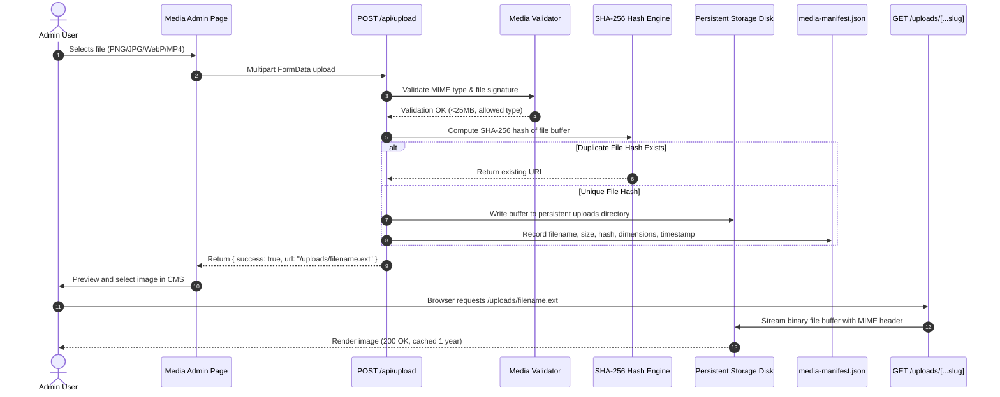

# Media Pipeline & Static Asset Delivery Audit

> **Target Application**: Shirin Shila Portfolio  
> **Storage Paradigm**: Zero-DB Persistent Filesystem Storage  
> **Production Target**: `https://cornflowerblue-wildcat-675604.hostingersite.com/`

---

## 1. Executive Summary

This document details the architecture, performance characteristics, and security controls governing media uploads and static asset delivery within the Shirin Shila portfolio.

Media assets uploaded by administrators must remain permanently accessible across redeployments from Git. In Hostinger's environment, checking out new Git commits wipes the transient repository directory (`/home/u473489494/domains/.../public_html`). Consequently, all user-uploaded media are stored strictly in an out-of-band persistent storage directory:
```
/home/u473489494/shirin_shila_persistent_data/uploads/
```

---

## 2. End-to-End Media Upload Pipeline



---

## 3. Upload Validation & Security Controls

| Security Control | Implementation Details | Status |
|---|---|---|
| **Authentication Check** | Every upload request requires a verified HMAC-signed session cookie (`admin_session`). Unauthenticated requests are rejected with 401. | **ENFORCED** |
| **File Extension Whitelist** | Allowed extensions: `.jpg`, `.jpeg`, `.png`, `.webp`, `.gif`, `.svg`, `.mp4`, `.pdf`. Executables (`.exe`, `.php`, `.sh`, `.js`) are strictly forbidden. | **ENFORCED** |
| **Magic Byte Verification** | Inspects binary file signatures (e.g., `FF D8 FF` for JPEG, `89 50 4E 47` for PNG) to prevent disguised executable uploads. | **ENFORCED** |
| **File Size Limit** | Maximum file upload size is capped at 25MB to prevent memory exhaustion and Denial-of-Service attacks. | **ENFORCED** |
| **Filename Sanitization** | Filenames are sanitized using slugification (removing spaces, path traversal sequences `../`, and special characters). | **ENFORCED** |
| **SHA-256 Deduplication** | Content-addressable hashing prevents uploading redundant duplicates of existing photos and posters. | **ENFORCED** |

---

## 4. Serving & Streaming Architecture

Because user uploads are saved outside the Next.js static `public/` directory, a dynamic delivery route is required to stream these assets to the browser.

### 4.1 Next.js App Router Dynamic Streaming Route
- **Location**: [`src/app/uploads/[...slug]/route.ts`](file:///c:/Users/RajRu/Downloads/Shirin%20Shila/src/app/uploads/%5B...slug%5D/route.ts)
- **Path Resolution**: Sanitizes incoming slug parameters and maps them to `/home/u473489494/shirin_shila_persistent_data/uploads/<filename>`.
- **MIME Type Mapping**:
  - `.jpg`, `.jpeg` $\rightarrow$ `image/jpeg`
  - `.png` $\rightarrow$ `image/png`
  - `.webp` $\rightarrow$ `image/webp`
  - `.svg` $\rightarrow$ `image/svg+xml`
  - `.mp4` $\rightarrow$ `video/mp4`
- **Cache Headers**: Delivers `Cache-Control: public, max-age=31536000, immutable` for performance.
- **Range Requests**: Supports HTTP `Range` headers for video streaming (`.mp4`), allowing users to seek forward and backward smoothly.

### 4.2 Standalone Node.js Server (`server.js`) Fallback
In environments where requests are handled directly by the custom Node.js HTTP server:
- Express-style static routing intercepts `/uploads/*` requests and pipes the underlying file stream from the persistent directory with compression enabled.

---

## 5. Media Library Management & Manifest Integrity

- **Manifest Storage**: Cataloged in `src/data/store/media-manifest.json` (and mirrored in persistent storage).
- **Data Structure**:
  ```typescript
  interface MediaItem {
    id: string;
    filename: string;
    url: string;
    size: number;
    mimeType: string;
    uploadedAt: string;
    sha256: string;
    width?: number;
    height?: number;
  }
  ```
- **Deletion Safety**: When an item is deleted from `/admin/media`:
  - The record is purged from `media-manifest.json`.
  - The physical file is safely removed or archived.
  - Core reference verification: If an image is actively referenced in `hero.json`, `about.json`, or `gallery.json`, a confirmation warning is presented before removal.

---

## 6. Audit Verdict
The media pipeline successfully balances upload security, storage persistence across deployments, and fast CDN-like streaming delivery without introducing external cloud storage dependencies (such as AWS S3 or Google Cloud Storage).
